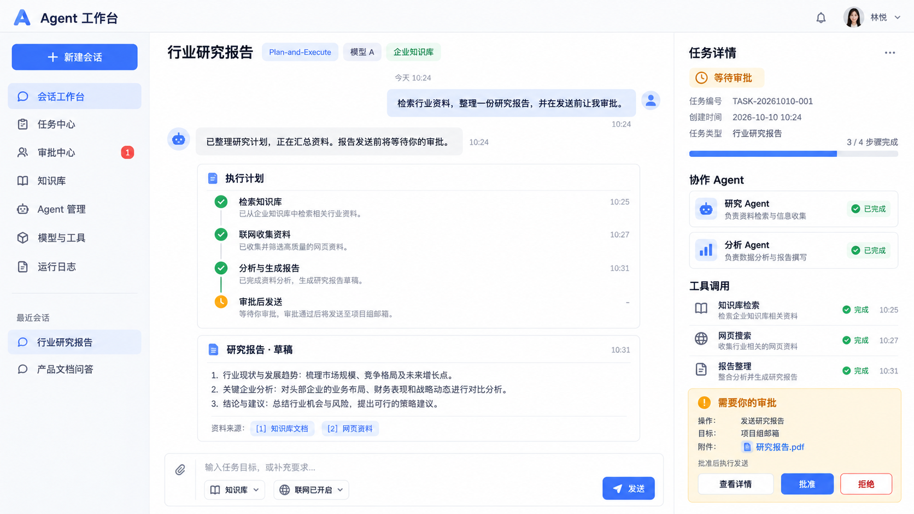

# Infi AI Agent

前后端分离的 AI Agent 工作台，基于 Java 17、Spring Boot、LangChain4j 和 Vue 3。支持用户管理、三种 Agent 执行模式、多模型切换、会话记忆、RAG 知识库、MCP 工具、邮件发送，以及由模型发起、当前用户本人确认的人工审批。

## 当前能力

| 能力 | 说明 |
| --- | --- |
| ReAct | 模型按需选择工具，根据真实工具结果继续执行或回答 |
| Plan-and-Execute | 生成计划、逐步执行并汇总，整次任务共享预算 |
| Multi-Agent | 协调 Agent 分工，专业 Agent 在独立上下文中执行，审校 Agent 核对证据 |
| 多模型 | 支持多个 OpenAI 兼容模型，每次任务可切换模型，模型需支持工具调用 |
| 工具 | 计算、当前时间、文件增删读写和目录浏览、网页搜索和 HTTP GET、纯文本邮件、MCP 工具 |
| RAG 知识库 | 文档上传、处理状态、检索测试、来源引用及原文下载；使用 MySQL、MinIO 和 Elasticsearch |
| 会话记忆 | 三种模式共享所属会话的近期公共对话，支持历史分页、改名、清空和删除 |
| 人工审批 | 模型通过 `request_approval` 请求当前用户确认具体操作，批准后继续，拒绝则停止 |
| 用户系统 | 注册、登录、个人资料、改密，以及管理员用户管理；接口使用 Bearer 认证 |

Multi-Agent 的专业角色包括计算、时间、文件、联网、知识库、邮件、MCP 和分析。角色权限由服务端固定，协调、专业执行和审校共用整次任务的执行预算与 Token 统计。

## 环境

- JDK 17、Maven 3.6.3+
- Node.js 22.12+（或 20.19+）
- MySQL 8、Redis 6+
- 启用 RAG 时还需要 MinIO、Elasticsearch 及兼容的向量模型服务
- 启用邮件发送时需要可用的 SMTP 配置；网页搜索需要搜索服务密钥

## 初始化与启动

### 1. 初始化数据库

按顺序执行：

1. `sql/001_user.sql`：创建 `infi_agent` 数据库和用户表。
2. 在同一数据库执行 `sql/002_conversation.sql`：创建会话和历史轮次表。
3. 在同一数据库执行 `sql/003_knowledge.sql`：创建知识库文档表。

后端不会自动执行以上业务初始化脚本。人工审批复用现有会话历史，不需要新增审批表。

### 2. 配置本地环境

编辑或新建 `src/main/resources/application-local.yml`。默认启用 `local` profile，该文件被 Git 忽略，用于保存本机配置。也可通过环境变量覆盖相应设置。

需要核对：

- **数据库**：连接地址、用户名、密码。初始化脚本创建的是 `infi_agent`，当前 `application.yml` 的连接地址默认使用 `infi_agent_it`，启动前应将 `MYSQL_URL` 或 local 文件中的连接地址改为实际初始化的数据库。
- **Redis**：主机、端口、密码和数据库编号。
- **模型**：当前配置使用 `app.ai.models` 模型目录和 `app.ai.default-model`。现有两个模型的凭证占位分别为 `DEEPSEEK_API_KEY`、`DASHSCOPE_API_KEY`；请提供对应环境变量，或按实际模型调整配置及占位。多模型配置见 [多模型使用说明](docs/多模型使用说明.md)。
- **首次管理员**：在空用户表上启动前设置 `BOOTSTRAP_ADMIN_USERNAME`、`BOOTSTRAP_ADMIN_PASSWORD`，或 local 文件中的对应字段。密码要求为 8–64 位可见 ASCII 字符。管理员初始化后清空初始化密码配置。公开注册始终创建普通用户。

当前仓库 `application.yml` 的功能开关如下；local 文件或环境变量可以覆盖：

| 功能 | 当前配置 | 使用前准备 |
| --- | --- | --- |
| RAG | `app.rag.enabled=false` | 设置 `RAG_ENABLED=true` 并配置存储、索引和向量服务 |
| MCP | `app.mcp.enabled=true`，配置本地 stdio 服务 | 先打包生成 MCP 服务端 JAR；不使用时在 local 文件中关闭 |
| 邮件 | `MAIL_ENABLED` 默认 `true` | 配置自己的 SMTP 服务及授权码；不使用时设置 `MAIL_ENABLED=false` |
| 网页搜索 | `TOOL_SEARCH_ENABLED` 默认 `true` | 配置 `TAVILY_API_KEY`；不使用时设置 `TOOL_SEARCH_ENABLED=false` |

工作台中的“知识库”“联网”开关只授权本次任务使用对应工具，仍需服务端配置可用。真实凭证放在 local 文件或环境变量中，不提交到 Git。

### 3. 启动后端

在**项目根目录**执行：

```shell
mvn -DskipTests package
mvn spring-boot:run
```

当前配置端口为 `8126`。由于默认启用了本地 stdio MCP，首次启动前需要打包生成 `target/infi-ai-agent-0.1.0-mcp-stdio.jar`；关闭 MCP 后可直接执行 `mvn spring-boot:run`。更改服务端配置后需要重启后端。

### 4. 启动前端

在 `frontend` 目录执行：

```shell
npm install
npm run dev
```

访问 [本地工作台](http://127.0.0.1:5173)。Vite 将 `/api` 代理到 `http://127.0.0.1:8126`，修改后端端口时需同步调整 `frontend/vite.config.js`。

## 工作台与人工审批

登录后在“会话工作台”选择模型和处理方式，正常发送任务。前端使用 `/api/agent-tasks` 提交任务并轮询状态；三种模式都支持执行中的人工确认。

模型判断删除、覆盖重要文件、不可逆变更、对外提交、产生费用，或用户明确要求先确认的操作需要审批时，会调用 `request_approval`。审批卡片位于右侧“任务详情”栏底部，窄屏固定在右下角，完整参数通过“查看详情”展开。当前用户点击“批准”后执行卡片中的精确操作，点击“拒绝”则停止任务，无需切换管理员账号。

**审批由模型判断发起，并非后端对上述操作逐项强制拦截。** 普通问答、计算、只读查询和普通新建文件通常直接执行；批准也不会扩大角色、知识库或联网权限。

可以用临时文件验证：

1. 发送“创建 approval-demo.txt，内容为审批流程测试”。
2. 创建成功后发送“删除 approval-demo.txt，删除前必须先请求我确认”。
3. 先拒绝，再读取文件，确认仍然存在；重新提出删除任务并批准后，确认文件已删除。

文件工具默认目录为**后端启动目录下的 `tool-workspace`**，可通过 `TOOL_FILES_ROOT` 覆盖。从项目根目录启动时，测试文件位于 `tool-workspace/approval-demo.txt`。向模型描述或传入工具参数时使用 `approval-demo.txt` 这样的相对路径。

运行边界：

- 每个用户最多一个未结束任务；每次确认最多等待 5 分钟，一次任务最多确认 3 次，等待不消耗模型和工具执行时限。
- 页面刷新可找回当前进程中的未结束任务；后台暂停保留原调用栈，不会重新执行已完成步骤。
- 待确认状态保存在单实例进程内，后端重启后不能续跑，多实例部署需考虑任务路由与状态存储。
- 原有三个 `/runs` 同步接口保留兼容，不支持交互等待；需要审批的客户端应使用 `/api/agent-tasks`。

完整接口与限制见 [人工审批使用说明](docs/人工审批使用说明.md)。

## 执行预算、统计与日志

执行受到模型调用、工具调用、重复调用和任务时限约束，配置分别位于 `app.react`、`app.multi-agent`。三种模式统计模型服务返回的输入、输出和总 Token；未返回用量时显示“未提供”，部分统计会标明覆盖次数，不估算实际账单。

同轮连续的只读工具（计算、时间、网页搜索/读取、文件读取/列表）可并行执行，结果与轨迹保持请求顺序。文件修改、邮件发送、知识库检索和未知 MCP 工具按顺序执行。人工确认必须单独调用，混合审批与其他工具的批次不会执行。工具池为 8 个线程、64 个排队位置；工作台任务使用独立的有界后台线程池，配置见 `ExecutionConfiguration`。

日志使用 SLF4J：INFO 记录任务、模型与工具调用，WARN 记录停止原因，ERROR 记录调用异常。按执行结果中的 `runId` 可关联模型和工具日志；协作日志还包含 `agent`、`taskNumber`。日志包含 `finishReason`、Token 用量和输出上限，`LENGTH` 表示模型输出被截断。并行执行可通过 `Tool group scheduled ... parallel=true` 和工具开始/结束时间戳判断。日志不主动打印请求密钥、完整会话、工具参数或结果正文。

## 验证

在项目根目录执行后端测试：

```shell
mvn test
```

在 `frontend` 目录执行：

```shell
npm test
npm run build
```

常规后端集成测试使用 H2 和模拟 Redis，不需要本地业务数据库。真实基础设施联调需显式在**项目根目录**执行：

```shell
mvn -Dtest=RealInfrastructureIT test
```

该测试使用本地配置的 MySQL 凭证及 Redis，默认连接独立的 `infi_agent_it` 测试库；可通过 `MYSQL_INTEGRATION_URL` 指定其他独立测试库。默认允许创建测试库，账号需具备相应权限。测试会初始化测试表、清理自己创建的账号与 Redis 键，并保留测试库表。

浏览器界面验证与真实模型、SMTP 或外部基础设施验证不同，模拟接口的页面测试不能证明外部服务实际可用。测试数量随功能迭代变化，以本次执行报告为准。

## 部署

前端执行 `npm run build` 后，将 `frontend/dist` 部署到独立静态站点，由网关将 `/api` 转发至后端；后端不托管 Vue 文件，不开放任意跨域。生产环境使用 HTTPS。当前人工审批的进程内暂停机制需纳入部署和重启安排。

## 项目结构

```text
src/main/java/com/infi/agent/
  approval/        人工确认上下文与等待预算
  controller/      接口与参数校验
  service/         业务接口及 impl 实现
  multi/           Agent 角色、独立上下文与通用执行器
  react/           模型适配与工具注册、执行
  memory/          会话记忆与 Redis 缓存
  rag/             文档解析与知识库检索
  mcp/             MCP 客户端及本地 stdio 服务端
  mapper/          MyBatis 数据访问
  entity/          DO
  dto/、vo/        输入与输出
  config/          服务配置
  security/        认证与权限
  common/          公共响应、异常与执行日志
src/main/resources/mapper/  SQL 映射
frontend/src/               Vue 界面与接口封装
sql/                        数据库初始化脚本
src/test/、frontend/tests/  自动化测试
docs/                      使用说明与设计参考
```

## 使用说明与设计参考

- [ReAct](docs/ReAct使用说明.md)、[Plan-and-Execute](docs/Plan-and-Execute使用说明.md)、[Multi-Agent](docs/Multi-Agent使用说明.md)
- [多模型配置](docs/多模型使用说明.md)、[会话记忆](docs/会话记忆使用说明.md)
- [文件、网页等工具](docs/工具使用说明.md)、[邮件发送](docs/邮件发送使用说明.md)
- [RAG 知识库](docs/RAG使用说明.md)、[MCP 接入](docs/MCP使用说明.md)、[stdio MCP 服务端](docs/stdio-MCP服务端使用说明.md)
- [人工审批](docs/人工审批使用说明.md)、[用户系统接口](docs/用户系统接口.md)、[需求文档](docs/需求文档.md)

项目自带的 stdio MCP 服务端开放计算与时间工具，打包后可通过 `java -jar target/infi-ai-agent-0.1.0-mcp-stdio.jar` 启动。

下图为目标界面设计参考，部分功能尚未实现，以当前代码和上述使用说明为准。


