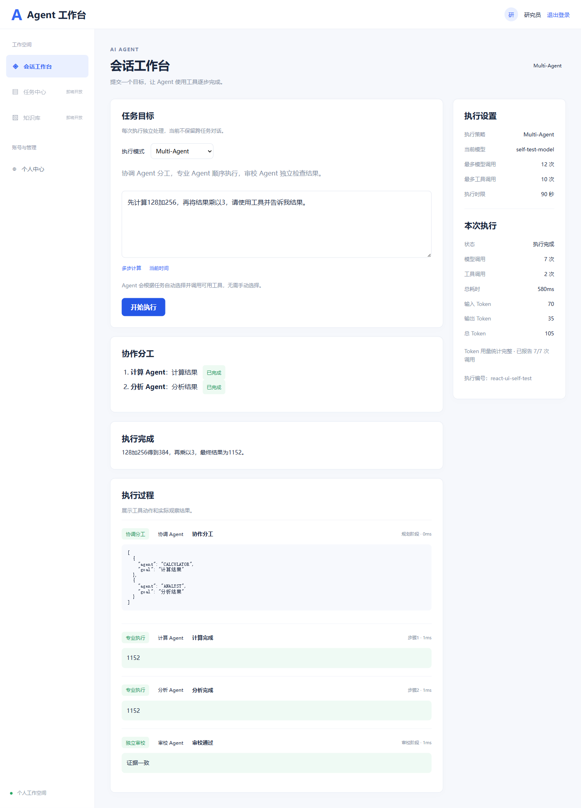

# Multi-Agent 协作使用说明

工作台选择 Multi-Agent，输入目标后执行。首版采用同步、顺序执行的“协调者—专业执行者—审校者”模式。

## 固定角色

| Agent | 职责 | 工具权限 |
| --- | --- | --- |
| 协调 Agent | 将目标拆分并分配角色任务 | 无 |
| 计算 Agent | 精确计算并交付实际结果 | calculator |
| 时间 Agent | 查询当前日期时间和时区 | current_time |
| 分析 Agent | 根据已有资料及其他 Agent 结果分析 | 无 |
| 审校 Agent | 独立核对各结果和工具证据，再汇总 | 无 |

角色共用已配置的模型，但拥有独立的系统职责、消息上下文和服务端工具权限。
只传递此前任务的结构化结果及实际工具证据，不传递专业 Agent 的完整模型对话或内部思维链。
工具调用参数仍由模型决定；前端不选择工具。

## 协作流程

1. 协调者输出严格 JSON 分工，最多4个子任务，每个目标最多500字：
   `{"tasks":[{"agent":"CALCULATOR","goal":"计算128加256"},{"agent":"CALCULATOR","goal":"将此前结果乘以3"},{"agent":"ANALYST","goal":"整合结果"}]}`。
2. 按数组顺序执行，后续任务可使用此前结果，隐含顺序依赖；轨迹中的 iteration 是子任务序号，runId 标识父执行。
3. 专业角色在独立上下文内执行局部工具循环，服务端过滤模型可见工具，并再次校验实际调用是否属于当前角色。
4. 审校者收到目标、分工、结果与真实工具观察，返回 `{"approved":true,"answer":"最终回答","reason":"审校说明"}`。
5. 审校未通过、输出不合法、调用失败或预算终止时返回失败或限制状态，保留已经产生的协作轨迹与 Token 用量。

审校是模型角色的结果检查，不是 Human-in-the-Loop 人工审批。当前不自动重新分工。
规划/审校阶段不能执行工具，禁止给 COORDINATOR、REVIEWER 递归分配专业子任务。
不支持未知角色、模型自定义工具权限、创建任意 Agent 网络或权限扩张。

## 接口与预算

登录后访问 `GET /api/multi-agent/config`，返回公开模型状态和协作预算。
`POST /api/multi-agent/runs` 请求仅包含 `{"goal":"计算1加2、查询上海时间并整合结果"}`，目标最多2000字。
用户身份来自 Bearer 认证，不读取请求体用户 ID。

返回沿用执行结果字段，steps 新增 agentName。
COORDINATE 表示协调，AGENT 表示专业任务完成，REVIEW 表示审校；MODEL 与 TOOL 是角色内部公开动作。
“协作分工”的 arguments 是带 agent、goal 的分工数组，页面显示任务完成状态及执行角色。
tokenUsage 累计整次协作全部模型回复的输入、输出和总 Token，缺失/部分用量如实标明。

application.yml 中 app.multi-agent 默认配置：

```yaml
max-iterations: 12
max-tool-calls: 10
max-repeated-calls: 2
max-tasks: 4
task-timeout: 90s
```

这些是整次协作的总预算，包括协调、专业循环和审校，不是每个 Agent 单独获得一份。
ReAct 与 Plan-and-Execute 继续使用原来的 app.react 配置。
敏感模型配置沿用 application-local.yml，本阶段未修改凭证。

## 当前边界

不增加并行或异步执行、取消/重分配、会话持久化、检查点恢复、Agent 配置管理页、模型运行时切换、MCP、RAG、联网或人工审批。
同一请求可以分配多个不同专业角色，也可以将有依赖的任务交给同一专业角色，分配由协调模型完成。

示例目标：“计算128加256并把结果乘以3，查询上海当前时间，再整合说明。”较复杂目标可能达到预算上限；页面保留已完成结果。

## 验证

后端测试覆盖协调分工、三种专业角色的结果交接、真实工具证据、越权工具拦截、审校拒绝、非法分工及递归角色、任务数量和长度边界、共享调用预算、超时、Token 累计、权限及真实 LangChain4j 客户端对本地 HTTP 模型替身的完整协议。
前端测试覆盖三种模式接口；浏览器检查覆盖角色分工、审校与 Token 展示、桌面/移动布局。
没有调用真实付费外部模型，实际模型效果需结合所配置模型能力验证。




本阶段验证结果：94 项后端测试、7 项前端接口测试、生产构建及桌面/移动端浏览器检查全部通过。后端包含真实 LangChain4j 客户端对本地 HTTP 模型替身的协作协议验证；浏览器接口为模拟数据，未调用真实外部模型。
