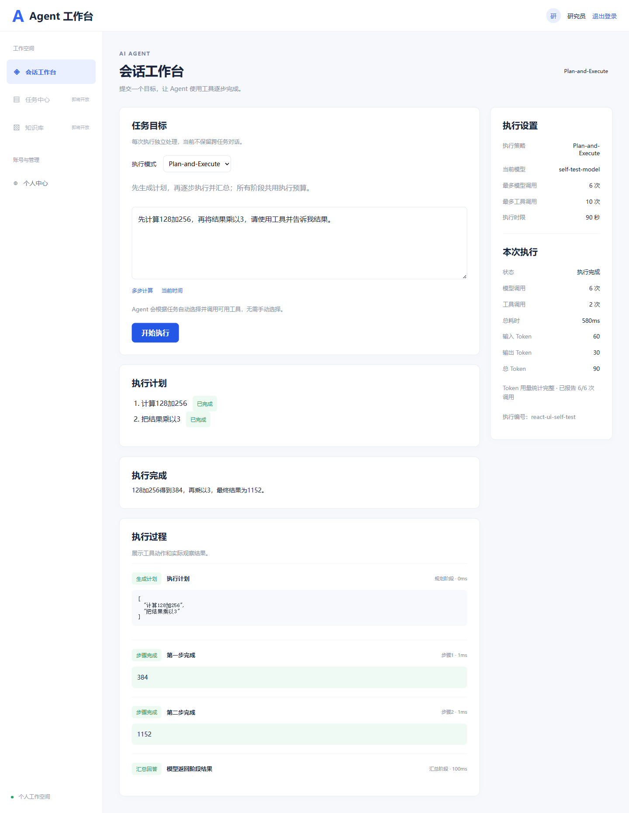

# Plan-and-Execute 使用说明

在会话工作台选择 Plan-and-Execute，填写目标后开始执行。工具由模型自动选择。

## 执行流程

1. 规划：请求模型输出严格 JSON，例如 `{"steps":["计算128加256","把第一步结果乘以3"]}`。不提供工具，拒绝规划器提出的工具调用。
2. 执行：按计划顺序处理每步。模型可以调用已注册工具；服务端执行后将真实观察反馈给模型。前一步完成结果传给后一步。
3. 汇总：把原始目标、计划和各步结果交给模型生成最终回答，不提供工具。

这是固定计划的同步顺序执行模式，当前不自动重规划。某一步失败或预算终止后停止后续步骤，并保留已有轨迹。请求结束后不持久化上下文。

## 接口

`POST /api/plan-execute/runs`，需要 Bearer 登录令牌。

```json
{"goal":"先计算128加256，再将结果乘以3"}
```

仅接收目标，必填且最多2000字。用户身份来自已验证令牌。
结果沿用执行结果结构：runId、status、answer、stopReason、modelCalls、toolCalls、durationMs、steps。
轨迹新增 PLAN（规划）、STEP（步骤完成）、FINAL（汇总），MODEL 和 TOOL 用于步骤内的模型决策及工具观察。
PLAN 中“执行计划”的 arguments 是计划字符串数组；iteration 表示计划步骤号，规划阶段为0。

## 预算和边界

复用 application.yml 的 app.react 配置：max-iterations、max-tool-calls、max-repeated-calls、task-timeout。
所有阶段累计预算，规划与汇总也计入模型次数。默认模型最多6次、工具10次、重复参数2次、总时限90秒。
计划最多4步，且不超过模型次数预算减2；每步最多500字。若预算不足，返回 LIMIT_REACHED。
工具只能来自服务端注册表。参数、重复调用及观察反馈沿用现有 @Tool 工具实现。
不保存或展示模型内部思维链。没有增加 MCP、RAG、多 Agent、审批、联网、异步或并行执行。
服务端不记录模型凭证或原始异常响应。

## 本地验证

`mvn test` 验证完整流程、步骤间结果传递、错误观察修正、非法计划、工具白名单、共享预算、超时、失败信息隐藏及接口权限。
`npm test`、`npm run build` 验证前端接口和构建；浏览器测试使用模拟接口。
真实外部模型仍需按本机配置验证其 JSON 规划输出和工具调用能力。


## 界面与验证记录



本阶段及 Token 统计验证：65 项后端测试（含真正 LangChain4j 客户端与本地 HTTP 模型替身的完整计划流程）、6 项前端接口测试、生产构建及桌面/移动端浏览器检查。测试没有调用真实付费外部模型。


## Token 用量

执行结果增加 tokenUsage：inputTokens（输入）、outputTokens（输出）、totalTokens（总数）、reportedModelCalls（返回用量的调用数）、complete（统计是否完整）。工作台在“本次执行”显示累计用量。所有模型调用均计入，包括规划、工具观察反馈后的再次调用和汇总；工具自身不产生模型 token。

只统计模型服务在响应中返回的用量；总数缺失而输入与输出都已提供时，将两者相加。不估算未返回的消费，缺失字段为 null，页面显示“未提供”。部分调用未返回用量或请求失败时，显示部分统计及报告覆盖次数，已知累计值可能低于实际消耗。未调用模型时为0。此统计不是费用或账单，未额外计算缓存和推理 token 明细。
