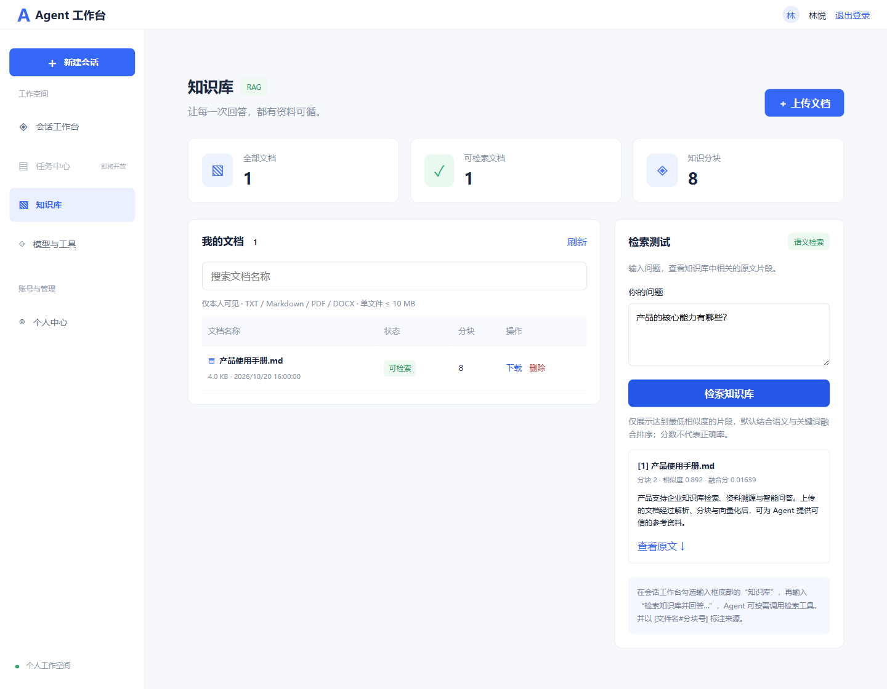

# RAG 知识库

知识库提供上传、文档列表、语义检索、原文下载和删除，按登录用户隔离。MySQL 保存文档元信息、处理状态、失败原因和存储位置；MinIO 保存私有原文；Elasticsearch 保存文本分块及 dense_vector。ReAct、Plan-and-Execute 可调用 `knowledge_search`；Multi-Agent 由 KNOWLEDGE 角色负责检索。回答按工具描述引用 `[文件名#分块号]`，检索测试页提供原文下载。审批不在本阶段范围内。



## 配置与运行

连接已有的 MinIO 和 Elasticsearch 服务，配置对应地址和凭证。生产环境须为 Elasticsearch 配置认证和 TLS，并使用受限 MinIO 服务账号。

在现有业务 MySQL 数据库执行 `sql/003_knowledge.sql` 创建 `ai_knowledge_document` 表。该脚本可重复执行，不修改既有用户和会话数据。

在 `application-local.yml` 的既有 `app` 节点下增加 `rag`，不要重复声明 `app`：

```yaml
app:
  rag:
    enabled: true
    minio-endpoint: http://localhost:9000
    minio-access-key: ${MINIO_ACCESS_KEY}
    minio-secret-key: ${MINIO_SECRET_KEY}
    bucket: agent-knowledge
    elasticsearch-url: http://localhost:9200
    elasticsearch-api-key: ${ELASTICSEARCH_API_KEY:}
    elasticsearch-username: ${ELASTICSEARCH_USERNAME:}
    elasticsearch-password: ${ELASTICSEARCH_PASSWORD:}
    elasticsearch-ca-certificate: ${ELASTICSEARCH_CA_CERTIFICATE:}
    index: agent-knowledge-v1
    embedding-url: https://api.openai.com/v1
    embedding-api-key: ${EMBEDDING_API_KEY}
    embedding-model: text-embedding-3-small
    dimensions: 1536
```

也可通过 `application.yml` 中对应的环境变量配置（开关 `RAG_ENABLED`）。Embedding 服务与聊天模型分别配置；须返回配置维度的非零向量。`dimensions` 只用于校验和 ES mapping，不向模型请求传递维度参数，因此应填入所选模型的实际输出维度。更换 embedding 模型或维度时必须更换 `RAG_INDEX` 并重新上传文件，禁止将不同模型向量混用。

首次请求延迟创建私有桶和 ES 索引，需要相关权限。关闭功能时不连接 RAG 外部服务；界面和工具会明确提示未启用。

### Elasticsearch HTTPS 与认证

启用 TLS 的 ES 必须使用 `https://`。自签名证书可通过 `elasticsearch-ca-certificate` 指定 CA 证书文件路径（相对路径以启动工作目录为准），例如 `.tools/rag-certs/http_ca.crt`。该配置只影响 ES 客户端，保留证书链与主机名验证。使用 Docker 中的现有 ES 时，可复制其公开 CA 证书：

```shell
docker cp es:/usr/share/elasticsearch/config/certs/http_ca.crt .tools/rag-certs/http_ca.crt
```

执行前先创建本地目标目录，容器名按实际情况替换。证书文件和本地凭证不提交到仓库。

支持两种认证：填写 `elasticsearch-api-key` 使用 ES 生成的编码 API Key；或留空 API Key，填写 `elasticsearch-username` 和 `elasticsearch-password` 使用 Basic 认证。两者同时配置时 API Key 优先。账号密码不能放在 API Key 字段里。修改配置后须重启后端。

证书加载、TLS 验证、401 认证和 403 权限失败会返回对应提示，避免把存储初始化错误误认为 Embedding 故障。

### 上传后索引失败

上传需要实际调用 Embedding。若模型返回 `insufficient_quota`，表示模型账户额度不足；例如阿里云服务可能提示免费额度已耗尽，需在模型平台检查余额及“仅使用免费额度”设置，或改用具备额度的 Embedding 服务。系统不会自动调整计费设置。恢复额度后，删除失败文档并重新上传。

Embedding 的额度、认证、接口不存在、调用受限及维度不匹配会分别提示。更换模型时应保持输出维度与配置一致；若切换到不同模型，需使用新索引并重新入库。

## 使用

1. 登录后打开左侧“知识库”，上传 UTF-8 TXT/Markdown、PDF、Word（DOC/DOCX）、Excel（XLS/XLSX）、PowerPoint（PPT/PPTX）、HTML、RTF 或 OpenDocument（ODT/ODS/ODP）。单文件不超过 10 MB，提取文本上限 20 万字符，默认每块 800 个 Unicode 码点，重叠 120。文档由 Apache Tika 统一提取文本，显式关闭 OCR；图片内文字不参与检索，扫描 PDF 不提供 OCR。
2. 上传为同步操作，先存原文，再分块请求 embedding 并写 ES，全部成功才发布为“可检索”。大量分块可能耗时较长，反向代理需设置足够长的超时。
3. 右侧“检索测试”展示最多 5 个通过相似度门槛的片段、来源、余弦相似度及融合分。允许少于 5 条或返回空结果，不再强行补足数量。结果是相关性排序，不保证有答案；Agent 应在证据不足时明确说明。
4. 回到会话工作台，先勾选输入框底部的“知识库”，再输入“请检索我的知识库，回答……并标注来源”。模型可按需检索，执行详情保留实际片段及文档编号。Multi-Agent 可在用户授权后分配知识库 Agent。
5. 删除先在 MySQL 撤销发布状态，再删除 ES 分块和 MinIO 原文。全部清理完成后保留不可见的 DELETED 标记。删除失败时保留“待完成删除”和失败原因，可再次点击删除重试。

### 相关性门槛、关键词召回与重排

`app.rag.retrieval` 提供以下配置（本地可在已有 `app.rag` 下添加）：

```yaml
retrieval:
  min-score: 0.55
  hybrid-enabled: true
  candidate-size: 30
  rrf-k: 60
  vector-weight: 0.7
  keyword-weight: 0.3
```

对应环境变量为 `RAG_MIN_SCORE`、`RAG_HYBRID_ENABLED`、`RAG_CANDIDATE_SIZE`、`RAG_RRF_K`、`RAG_VECTOR_WEIGHT`、`RAG_KEYWORD_WEIGHT`。修改后重启后端，不需要重新上传文件或重建现有索引。`min-score` 范围 -1–1，是原始余弦相似度下限；默认 0.55 仅作为起点，需要用实际模型和问题调优，提高会更严格，但可能漏掉相关资料。

混合检索流程：一次调用 Embedding 得到问题向量；向量和关键词 BM25 各召回最多 `candidate-size` 个候选（10–200）；按 ES 分块 ID 合并；对候选重新计算余弦相似度并严格执行门槛；最后在应用内按加权 RRF 重排，返回最多 `limit` 条。向量查询中 ES `min_score` 使用 `min-score + 1`，因为脚本为余弦值加了 1。关键词召回的候选同样必须通过余弦门槛，不能仅靠命中常见字就返回。每条查询均过滤用户、READY 文档编号和分块类型。

融合分为 `归一化向量权重/(rrf-k + 向量名次) + 归一化关键词权重/(rrf-k + 关键词名次)`，未进入某路候选则该项为零。接口原有 `score` 继续表示余弦值，新增可空的 `rerankScore` 表示 RRF 融合排序分，两者都不是正确率。该重排是排名融合算法，不是交叉编码器或 LLM 语义判别，不额外消耗聊天模型额度。技术依据见 [Elastic RRF 说明](https://www.elastic.co/docs/reference/elasticsearch/rest-apis/reciprocal-rank-fusion)。

关键词使用已有 `text` 字段的 ES 默认分析器及 BM25，不依赖 IK 插件。中文默认分词对人名、专业术语有局限；混合检索和阈值不能保证所有结果都相关。关闭 `hybrid-enabled` 时使用纯向量排序，仍执行最低分门槛，`rerankScore` 为空。没有满足门槛的片段会直接返回空数组。

### 检索次数与结果复用

会话输入框的“知识库”默认不勾选，新建或切换会话会重置为未勾选。发送任务时三个运行接口均接收 `useKnowledge` 布尔字段；缺省为 false。选择按当前轮次传递，带会话 ID 的执行也不会丢失或从历史继承选择。未勾选时，后端不向模型提供 `knowledge_search`，即使模型强行请求也会被拦截；Multi-Agent 不能分配 KNOWLEDGE 角色。勾选只表示允许按需检索，不保证每个问题都调用工具。知识库页面的“检索测试”不受会话输入框选项影响。

输入框默认高度已增加，输入或粘贴多行内容会自动增高，删除内容或发送后自动收缩；文本区最多为视口高度的 40% 且不超过 320px，更长内容在框内滚动，底部工具栏保持可见。

“知识库”旁提供独立的“联网”开关，默认关闭，新建或切换会话同样重置。三个执行接口接收 `useNetwork`（缺省 false），与 `useKnowledge` 可任意组合。未开启联网时不向模型提供内置 `web_search` 和 `http_get`，强制调用也会被拦截，Multi-Agent 禁止分配 NETWORK 角色；开启后仍需后端已配置对应工具。该开关控制公开网页搜索和读取，不影响模型服务、MinIO、ES 等应用基础连接。

一次 Agent 任务默认最多实际检索 3 次，通过 `app.rag.max-searches-per-run` 或 `RAG_MAX_SEARCHES_PER_RUN` 配置（1–10）。ReAct、Plan-and-Execute 的全部步骤和 Multi-Agent 的全部角色共享整次任务预算，不能通过重新分配子任务绕过上限。

相同用户、相同查询在任务内复用成功结果，包括空结果；比较时仅去除首尾空白并合并连续空白，不合并不同语义的查询。缓存不跨请求、会话轮次或用户共享。短时服务错误允许在剩余预算内重试；额度不足、认证/权限失败、模型不存在、证书或维度配置错误会关闭本次任务的后续真实检索。达到上限或遇到不可重试错误后，后续模型请求不再提供检索工具，并要求依据已有证据回答或说明资料不足。

执行轨迹区分实际工具执行、任务内结果复用、不可重试错误和已拦截请求。界面的“工具调用次数”仍统计模型发起的工具尝试，包含缓存和已拦截请求；实际检索预算不包含缓存复用。直接点击知识库页面的“检索测试”是独立请求，不使用 Agent 任务缓存。

每个用户最多 500 份未删除文档（常规请求限制，非并发配额锁），列表由 MySQL 按时间倒序返回，ES 或 MinIO 不可用时仍能查看状态和失败原因。检索按 MySQL 中 READY 文档 ID、所属用户及当前模型配置过滤；与当前模型、维度或索引不兼容的历史文档不参与检索，避免混用向量。文档记录保存原始桶、对象键、索引和模型配置，修改默认桶或索引后仍可下载和删除旧文档。文档名只作展示，下载经后端鉴权。文件和检索片段为不可信数据，不能视为系统指令。

索引失败时 MySQL 保存 FAILED 状态及脱敏失败原因，保留已存原文及可能写入的分块供清理；失败分块不参与检索，可删除后重新上传。进程中断或最终状态写入失败可能留下 INDEXING；一小时后可删除清理。MySQL 写入使用短事务提交，不在整个上传过程持有跨网络长事务。暂不实现后台任务队列、自动补偿任务、多用户共享知识库、全文混合检索或 OCR。

## 接口

所有接口使用已有 Bearer 登录认证，身份从服务端认证上下文获取：

| 方法 | 路径 | 说明 |
| --- | --- | --- |
| GET | `/api/knowledge/documents` | 当前用户文档列表 |
| POST | `/api/knowledge/documents` | multipart/form-data，字段 `file` |
| GET | `/api/knowledge/documents/{id}/content` | 当前用户原文下载 |
| DELETE | `/api/knowledge/documents/{id}` | 删除原文、向量与元信息 |
| POST | `/api/knowledge/search` | JSON `{"query":"问题","limit":5}`，limit 为 1–10 |

向量检索基于 [Elasticsearch script_score / cosineSimilarity](https://www.elastic.co/docs/reference/query-languages/query-dsl/query-dsl-script-score-query)，先按用户、类型和 READY 文档编号过滤，再计算余弦相似度。该实现适合当前受限规模，大规模数据应改用近似 kNN。原文操作使用 [MinIO Java SDK](https://minio-java.min.io/io/minio/PutObjectArgs.html)。

## 验证

后端 `mvn test`；前端 `npm test`、`npm run build`。RAG 单元测试模拟存储和向量服务，验证权限隔离、READY 发布屏障、失败状态、删除顺序、检索过滤、UTF-8 解析和 Unicode 分块。真实联调需要启动上述服务并提供 Embedding 凭证，单元测试不代表真实基础设施联调通过。

可选真实存储测试：设置 `RAG_INFRASTRUCTURE_TEST=true`、`RAG_IT_MINIO_KEY`、`RAG_IT_MINIO_SECRET`，执行 `mvn -Dtest=RagInfrastructureIT test`。可通过 `RAG_IT_MINIO_URL`、`RAG_IT_ES_URL` 和 `RAG_IT_ES_KEY` 覆盖连接。测试创建随机 UUID 命名的测试桶及索引，执行真实上传、检索、下载、跨用户隔离及删除，然后清理；Embedding 使用本地 HTTP 协议替身，未调用外部模型。HTTPS ES 使用 JVM 信任库验证证书，不提供跳过证书验证的开关。

设置 `RAG_IT_USE_LOCAL=true` 时，该测试读取 application 配置，使用真实业务 MySQL、MinIO 和 ES（包含配置的 CA 证书和认证）；先执行建表 SQL。测试使用随机桶及索引，以及独立测试用户编号 99101 的记录，结束后按唯一测试索引清理记录，不修改真实用户文档。默认模式下元信息使用 H2。

本次已在 MinIO RELEASE.2025-04-22T22-12-26Z、Elasticsearch 8.19.20 上通过上述真实存储测试。桌面和 390px 手机布局及上传、检索、确认删除操作已通过浏览器检查（页面接口使用模拟数据）。外部 Embedding 模型效果和真实聊天模型端到端引用质量仍需使用实际模型配置验证。

MySQL 元信息重构后，179 项后端测试（含真实 MySQL / MinIO / HTTPS ES 链路）、10 项前端测试、生产构建及浏览器交互检查通过。本地业务表已初始化。新增验证覆盖外部存储离线时读取列表、失败原因持久化、原子状态切换、跨用户 SQL 条件、删除补偿和删除标记。
