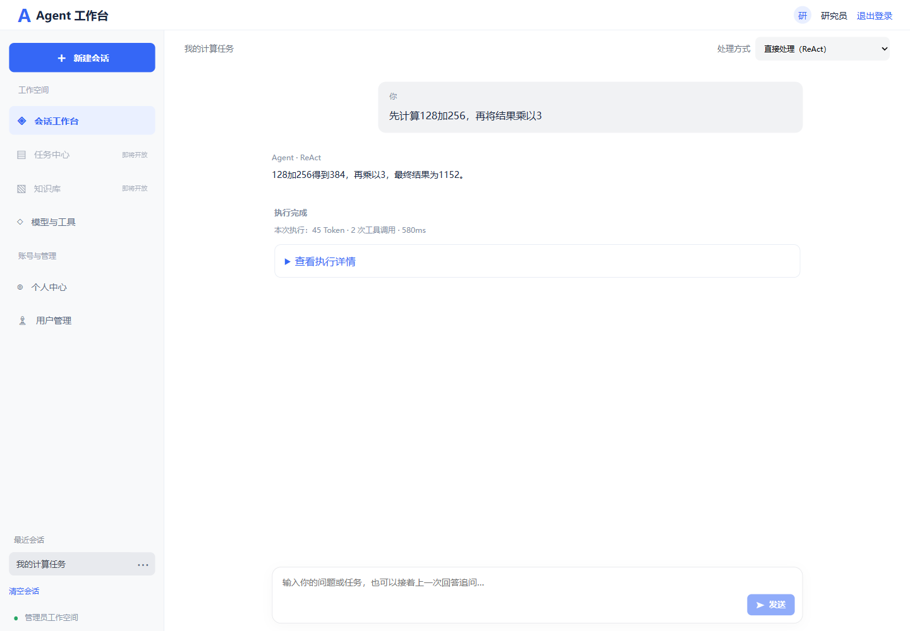

# 会话记忆使用说明

日期：2026-10-13。ReAct、Plan-and-Execute 和 Multi-Agent 已支持同一用户会话的近期对话记忆。

## 使用方式

会话工作台增加会话选择、新建、历史、清空和删除操作。首次发送时自动创建会话，也可主动新建。
继续在同一会话发送“我叫小周”，下一轮发送“我叫什么”，模型请求会包含上一轮公开对话。
切换执行模式仍可使用该会话的公共历史；新建会话和其他用户均不会共享记忆。
刷新页面后可重新选择所属会话，浏览完整执行轮次的历史。失败轮次显示在历史中，但不加入模型记忆。

## LangChain4j接入

项目类 `com.infi.agent.memory.RedisChatMemoryStore` 实现 LangChain4j 标准 `ChatMemoryStore` 接口，
使用官方 `ChatMessageSerializer` / `ChatMessageDeserializer` 编解码，并交由
`MessageWindowChatMemory.builder().chatMemoryStore(memoryStore)` 管理消息窗口。

这是项目内的MySQL加Redis双存储实现，复用现有Spring Redis连接，不是额外引入community模块的同名类，不要求RedisJSON。
官方接口允许自定义持久化存储，记忆窗口和完整历史是不同概念：[LangChain4j Chat Memory 文档](https://docs.langchain4j.dev/tutorials/chat-memory/)。

## 存储与一致性

- MySQL `ai_conversation`：所属用户、标题、有限记忆JSON、版本及执行租约。
- MySQL `ai_conversation_turn`：完整目标、执行模式、最终回答、完成状态、执行结果JSON及创建时间。
- Redis `agent:chat-memory:{userId}:{conversationId}`：带版本的窗口缓存，默认24小时有效。

每次读取先用MySQL元数据检查归属和当前版本，再使用匹配版本的Redis窗口。
缓存未命中、版本过旧或损坏时从MySQL恢复；Redis记忆缓存不可用时，记忆层可继续使用MySQL。
认证令牌仍由既有Redis登录系统管理，这个回退不改变认证系统对Redis的依赖。

保存先写MySQL，完整轮次与成功记忆窗口在同一短事务提交；Redis仅在提交后发布。
回滚不会发布新记忆。更新失败时不把未持久化消息当作成功保存。
同一会话执行、清空和删除需持有MySQL原子租约，冲突返回409；过期请求不能使用旧令牌覆盖新写入。
模型调用不在数据库事务内，不长时间占用数据库行锁。服务实例无需保存跨请求的内存状态。

## 记忆窗口与角色隔离

application.yml：

```yaml
app:
  chat-memory:
    max-messages: 20
    max-characters: 32000
    cache-ttl: 24h
```

默认最多20条消息，即10个完整成功轮次，还受序列化字符预算限制。
max-messages须为偶数。窗口按完整用户/最终回答对淘汰，不产生孤立消息。
超过窗口的完整历史仍在MySQL；过大的单轮也可能不进入有限窗口。
没有引入历史摘要、跨会话长期事实、RAG或自动偏好提取。

公共记忆只包含用户文本和最终回答，不包含系统提示、工具协议、计划JSON或子Agent内部对话。
ReAct将其加入系统提示之后、当前输入之前；Plan-and-Execute的规划、执行、汇总接收同一公共历史。
Multi-Agent通过AgentTask的独立公共历史字段传入各Agent，并继续隔离各专业角色的内部消息和证据。
既有模型/工具预算及Token统计继续按本次执行累计，输入Token可能因为历史上下文增加而变化。

## 接口

全部需要Bearer登录令牌，用户ID从认证上下文读取。

| 接口 | 作用 |
| --- | --- |
| POST /api/conversations，body为 `{"title":"会话名称"}` | 创建所属会话，标题可省略 |
| GET /api/conversations | 最近50个所属会话 |
| GET /api/conversations/{id}/messages?beforeId=游标 | 每页最多50个完整轮次，按时间顺序返回；nextBeforeId获取更早历史 |
| DELETE /api/conversations/{id}/messages | 同时清空完整历史和模型窗口 |
| DELETE /api/conversations/{id} | 删除会话、历史和窗口 |

三种模式原执行请求新增可选conversationId：

```json
{"goal":"我叫什么","conversationId":"后端创建的UUID"}
```

不传conversationId时保留原独立执行行为；工作台默认自动创建并发送会话编号。
服务端校验编号格式和归属。其他用户读写或删除会话返回404，不泄露会话存在性。

## 初始化与验证

新环境在001_user.sql对应的数据库内执行 `sql/002_conversation.sql`，只增量创建会话表。
本机已在本阶段真实联调中执行增量建表，未修改既有用户或会话，测试产生的账号和会话已清理。
application-local.yml中的数据库、Redis及模型凭证未修改。

`mvn test`：H2/MyBatis真实事务配合可控Redis与模型，验证三模式连续历史、归属隔离、缓存恢复、
版本检查、租约冲突、过期写保护、事务回滚、窗口淘汰、失败归档、历史分页及输入校验。
`npm test`、`npm run build` 和浏览器验证新建/切换/刷新/清空/删除及移动布局。

真实MySQL/Redis验证显式执行：

```text
mvn -Dtest=ConversationInfrastructureIT test
```

该测试使用本机配置的业务库，CREATE TABLE IF NOT EXISTS增量建表，只创建和清理自己的临时账号、会话及Redis键。
模型使用替身，不调用真实付费模型。真实模型是否正确利用记忆仍取决于模型能力，可以用姓名例子手动验证。


## 本阶段验证结果

119 项常规后端测试、1 项真实 MySQL/Redis 联调、8 项前端测试、生产构建及桌面/移动端浏览器检查均通过。
本机业务库的 ai_conversation、ai_conversation_turn 已在真实联调中增量初始化，测试账号和会话已清理。
真实外部模型未调用，连续记忆的数据传递由模型替身验证。


