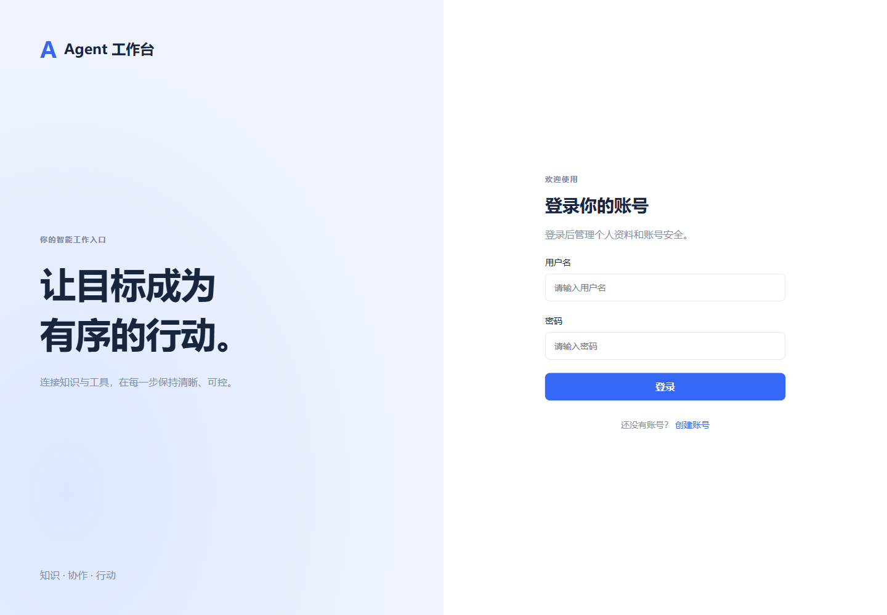
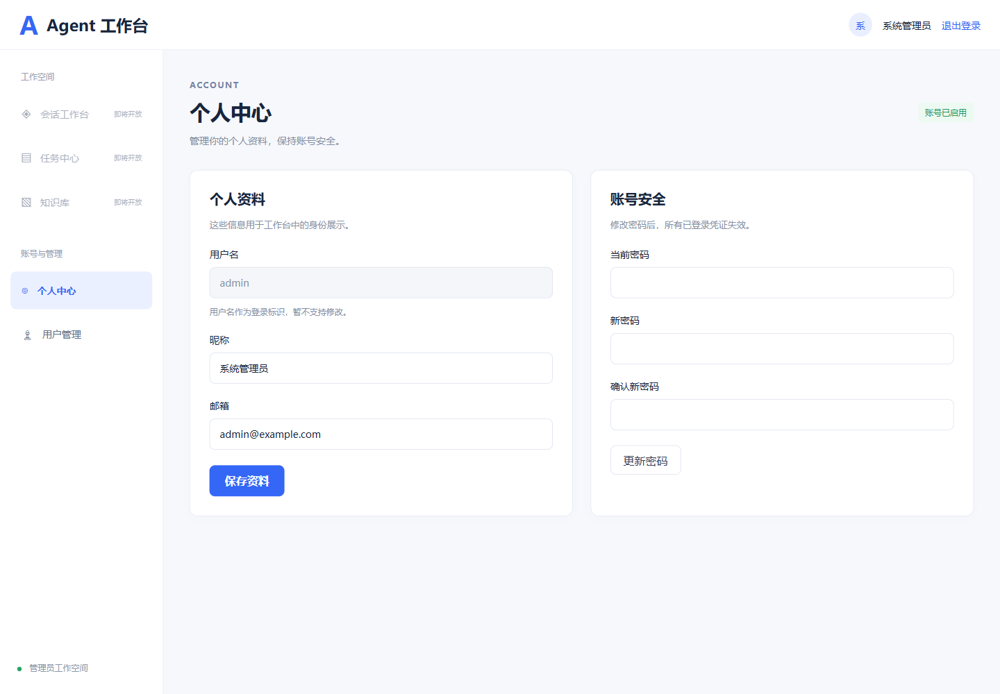
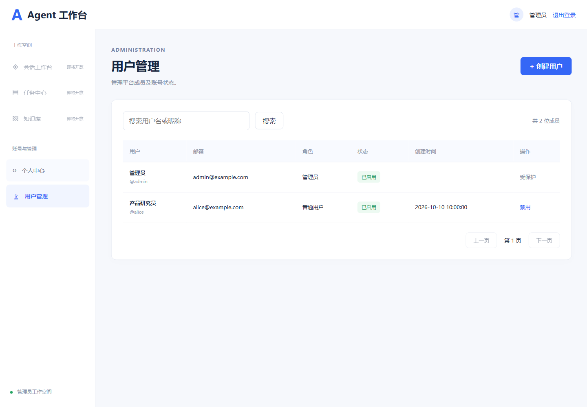

# 用户系统接口与实施范围

日期：2026-10-10。当前仅实现用户系统；Agent、RAG、MCP、任务和审批待后续阶段开发。

## 架构与规范

前后端分离：frontend 为 HTML / JavaScript / Vue 应用，backend 为 JDK 17 / Spring Boot / MyBatis 应用。LangChain4j 已加入依赖，本阶段不调用模型。

后端依赖方向：controller → service 接口 → service.impl → mapper → 数据库。DTO 用于输入，VO 用于输出，DO 用于持久化；配置与安全过滤器单独分包。遵循阿里 Java 规范中的命名、四空格缩进、构造器注入、绑定 SQL 参数、禁止 SELECT *、事务显式回滚、密码脱敏等要求。

## 接口

统一响应为 `{ "code": "OK", "message": "操作成功", "data": ... }`。失败返回对应 HTTP 状态及业务错误码。受保护接口通过 `Authorization: Bearer <token>` 认证。

| 方法 | 路径 | 权限 | 输入或行为 |
| --- | --- | --- | --- |
| POST | /api/auth/register | 公开 | username、password、nickname、email（可选）；只创建 USER |
| POST | /api/auth/login | 公开 | username、password；返回 token、expiresIn（秒）、user |
| POST | /api/auth/logout | 登录用户 | 使当前 Token 失效 |
| GET | /api/users/me | 登录用户 | 获取当前用户 |
| PUT | /api/users/me | 登录用户 | nickname、email；只修改本人资料 |
| PUT | /api/users/me/password | 登录用户 | oldPassword、newPassword；使所有旧 Token 失效 |
| GET | /api/admin/users | ADMIN | page 默认1、size 默认10上限100、keyword 最大50字；按用户名或昵称模糊查询 |
| POST | /api/admin/users | ADMIN | 同注册输入，创建普通用户 |
| PUT | /api/admin/users/{id}/status | ADMIN | status 为0禁用或1启用；本阶段不允许修改管理员状态 |

用户名以字母开头，由4–32位字母、数字、下划线组成，保存和登录时转小写。密码为8–64位可见 ASCII 字符、不含空格，避免 BCrypt 的72字节截断。昵称必填，最多50字；邮箱可选，最多100字。

不实现找回密码、邮件验证、删除账号、角色编辑或企业登录。用户注册后的邮箱属于未验证联系信息。

## 凭证与权限

Token 为安全随机生成的32字节 URL-safe 字符串，Redis 仅保存其 SHA-256 摘要对应的用户ID及凭证版本，默认8小时固定有效期。前端存入 sessionStorage，不采用自动发送的 Cookie，因此后端不使用 Cookie 会话与 CSRF 校验；生产需通过 HTTPS 访问。

每次请求查询用户状态和凭证版本。禁用、启用或修改密码都会递增版本，旧 Token 不恢复有效。退出仅撤销当前 Token。已进入执行的请求不承诺被中止。

登录按用户名及服务端取得的客户端IP限流，默认每15分钟最多10次尝试，包含成功登录。可信反向代理的真实IP配置需要部署时另行设置，不直接信任客户端提供的转发头。

注册不允许设置角色。管理员仅通过空用户表的显式启动配置初始化；部署时先完成初始化再开放注册。当前不支持通过界面新增管理员，避免开放角色升级入口。

## 页面

登录 / 注册页；个人中心（资料及密码）；管理员用户管理（搜索、分页、创建、启停）。页面使用已确认参考图的浅色、蓝色导航和卡片风格。未实现的 Agent 页面仅展示禁用导航入口。

## 测试边界

集成测试通过真实 HTTP 过滤链、Service 和 MyBatis SQL 验证业务流程，使用 H2 的 MySQL 兼容模式，并模拟 Redis 传输层。不能替代真实 MySQL / Redis 联调，上线前应运行同一流程验证数据库排序规则、连接及 Redis TTL / 原子限流行为。

另提供 RealInfrastructureIT，显式执行时使用真实 MySQL、Redis，默认连接独立的 infi_agent_it 测试库；不自动随常规单元测试执行。本次已完成实际联调，覆盖持久化、Token 有效期及过期、退出、改密、管理员权限和普通用户启停。

## 已实现页面截图

以下为浏览器渲染的实际页面，展示数据来自界面测试的模拟接口。

### 登录页

### 个人中心

### 用户管理

## 技术参考

依赖适配参考 [MyBatis 官方说明](https://mybatis.org/spring-boot-starter/) 和 [LangChain4j 官方入门文档](https://docs.langchain4j.dev/get-started/)。LangChain4j 本阶段仅加入依赖，后续功能再实现模型适配与调用。
